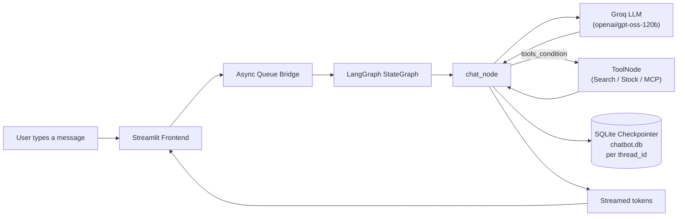

<div align="center">

# Chatbot_V2

### A stateful, tool-calling AI chat app powered by LangGraph, Streamlit & Groq

*Multi-conversation memory. Real-time token streaming. Tool calling & MCP integration. Durable SQLite persistence.*

[](https://www.python.org/)
[](https://streamlit.io/)
[](https://www.langchain.com/)
[](https://langchain-ai.github.io/langgraph/)
[](https://groq.com/)
[](https://modelcontextprotocol.io/)


</div>

---

## Overview

**Chatbot_V2** is a conversational AI application that goes beyond a single-turn chat wrapper. It models the conversation as a **compiled state graph** (via LangGraph) with **conditional tool-calling edges**, giving it a clean, extensible foundation for web search, live data lookups, and external MCP tool servers.

The app supports **multiple independent conversation threads** with **durable SQLite-backed checkpointing** (conversation state persists across restarts), a **live token-streaming UI** with inline tool-status indicators, and runs on **Groq's high-speed LLM inference** using the `openai/gpt-oss-120b` model.

---

## Key Features

| | |
|---|---|
| **Graph-based conversation engine with tool calling** | Built with LangGraph's `StateGraph`, defining the chat flow as `START → chat_node → (tools_condition) → tools → chat_node → END` — the LLM autonomously decides when to call tools and loops back for multi-step reasoning. |
| **Built-in tools** | **DuckDuckGo web search** for real-time information retrieval and a **stock price lookup** (via Alpha Vantage) for live market data — both bound to the LLM via LangChain's tool-calling interface. |
| **MCP server integration** | Connects to external **Model Context Protocol (MCP)** tool servers (stdio and streamable-HTTP transports) via `langchain-mcp-adapters`, making it easy to plug in additional capabilities without modifying the core graph. |
| **Multi-thread chat sessions** | Every conversation gets a unique `uuid4` thread ID. Users can start new chats, switch between past ones from the sidebar, and pick up right where they left off. |
| **Durable SQLite persistence** | LangGraph's `AsyncSqliteSaver` checkpointer stores each thread's full message history in a local `chatbot.db` file, so conversation state survives across app restarts — not just across turns. |
| **Real-time streaming responses** | Assistant replies are streamed token-by-token into the UI using `chatbot.astream(..., stream_mode="messages")` bridged to Streamlit's `write_stream` via a dedicated async event loop and queue. |
| **Inline tool-status UI** | When the LLM invokes a tool, an expandable status widget (🔧 *Using `tool_name` …*) appears in the chat, updating in real time and collapsing to ✅ *Tool finished* on completion. |
| **Auto-generated chat titles** | The sidebar automatically names each conversation from its first user message — no manual labeling needed. |
| **Async bridge architecture** | A dedicated background `asyncio` event loop (on a daemon thread) bridges Streamlit's synchronous runtime with LangGraph's fully async graph execution and streaming. |
| **Clean separation of concerns** | `backend.py` owns the graph, tools, LLM, and checkpointing logic; `frontend.py` owns the UI — decoupled and independently testable. |

---

## How It Works



1. The user sends a message in the Streamlit UI.
2. The message is added to that thread's state (`messages`) and dispatched to the compiled LangGraph graph via an async queue bridge.
3. The `chat_node` invokes the LLM (hosted on Groq) with the full message history and available tool definitions.
4. If the LLM requests a tool call, `tools_condition` routes to the `ToolNode`, which executes the tool (DuckDuckGo search, stock price lookup, or an MCP server tool) and loops back to `chat_node` for the LLM to interpret the result.
5. The `AsyncSqliteSaver` checkpointer persists the updated state to `chatbot.db` against the active `thread_id`, so conversations survive restarts and thread switches.
6. The response is streamed back to the UI token-by-token as it's generated, with tool invocations shown inline via status widgets.

---

## Tech Stack

| Layer | Technology |
|---|---|
| **Frontend / UI** | Streamlit |
| **Orchestration** | LangGraph (`StateGraph`, conditional edges, checkpointing) |
| **LLM Integration** | LangChain + `langchain-openai` (OpenAI-compatible client) |
| **Model Provider** | Groq (`openai/gpt-oss-120b` via `api.groq.com`) |
| **Tool Calling** | LangGraph `ToolNode` + `tools_condition` (conditional routing) |
| **Built-in Tools** | DuckDuckGo Search (`langchain-community`), Alpha Vantage Stock Price |
| **External Tools** | MCP servers via `langchain-mcp-adapters` (stdio & streamable-HTTP) |
| **State Persistence** | SQLite via `AsyncSqliteSaver` + `aiosqlite` (`chatbot.db`) |
| **Async Runtime** | Dedicated `asyncio` event loop on a daemon thread |
| **Language** | Python 3.10+ |

---

## Getting Started

```bash
# 1. Clone the repo
git clone https://github.com/nihal00753/Chatbot_V2.git
cd Chatbot_V2

# 2. Create a virtual environment
python -m venv venv
source venv/bin/activate   # Windows: venv\Scripts\activate

# 3. Install dependencies
pip install -r requirements.txt

# 4. Add your Groq API key
echo "GROQ_API_KEY=your_key_here" > .env

# 5. Run the app
streamlit run frontend.py
```

Get a free Groq API key at [console.groq.com](https://console.groq.com/).

---

## Project Structure

```
Chatbot_V2/
├── backend.py          # LangGraph state graph, LLM client, tools, MCP integration, checkpointing
├── frontend.py          # Streamlit UI, session state, sidebar, streaming, tool-status widgets
├── chatbot.db           # SQLite database for durable conversation persistence (auto-created)
├── requirements.txt     # Python dependencies
└── .gitignore
```

---

## What This Project Demonstrates

- Designing LLM applications as **graphs with conditional tool-calling edges**, not just linear prompt chains — a pattern that scales cleanly to multi-step reasoning and agent loops.
- **Autonomous tool selection** by the LLM: the model decides when to search the web, fetch stock prices, or invoke MCP tools, and the graph loops until it has a final answer.
- Integrating **external tool servers via the Model Context Protocol (MCP)**, showing how to extend an agent's capabilities without modifying its core graph logic.
- **Durable multi-session conversational state** with SQLite-backed checkpointing, surviving not just turn switches but full application restarts.
- Bridging **Streamlit's synchronous runtime with fully async LangGraph execution** using a dedicated event loop on a daemon thread and a queue-based streaming bridge.
- Building a **reactive, streaming UI** with inline tool-status indicators on top of a backend async generator interface.
- Integrating a third-party, OpenAI-compatible **LLM gateway** (Groq) instead of hardcoding a single vendor's SDK.

---

## Roadmap

- [x] ~~Move from in-memory checkpointing to durable **SQLite** persistence across restarts~~
- [x] ~~Add tool-calling nodes to the graph~~
- [x] ~~Integrate MCP tool servers~~
- [ ] User authentication for multi-user deployments
- [ ] RAG (Retrieval-Augmented Generation) node for document Q&A
- [ ] Deploy to Streamlit Community Cloud / Docker
- [ ] Conversation title generation from first message content

---

## Connect

Built by [**@nihal00753**](https://github.com/nihal00753) — feel free to open an issue or connect on GitHub.
