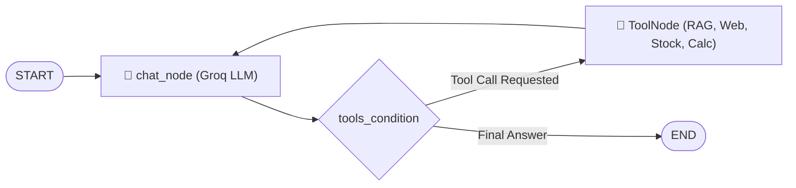

# Chatbot_V2

**A stateful, multi-utility AI assistant featuring PDF RAG, local embeddings, autonomous tool calling, and SQLite conversation persistence — powered by LangGraph, Streamlit & Groq.**

<div align="center">
  <a href="https://github.com/nihal00753/Chatbot_V2"></a>
  <a href="https://github.com/nihal00753/Chatbot_V2"></a>
  <a href="https://github.com/nihal00753/Chatbot_V2"></a>
</div>

---

## 📖 Overview

**Chatbot_V2** is a modular conversational AI application built on a compiled state graph (via **LangGraph**). Instead of running a linear chat loop, it models user interactions as an autonomous decision graph capable of calling external tools, searching the web, executing calculations, retrieving live stock prices, and performing semantic search (**RAG**) over user-uploaded PDF documents.

Conversation history is durably persisted in SQLite, allowing users to start, switch, and resume independent chat sessions seamlessly.

---

## 🚀 Key Features

| Feature | Description |
|---|---|
| **Graph-Based Conversation Engine** | Built with LangGraph's `StateGraph`, cycling through `chat_node → tools_condition → ToolNode → chat_node` until a complete answer is formed. |
| **PDF RAG (Retrieval-Augmented Generation)** | Upload PDFs directly from the sidebar. The document is chunked, embedded, and indexed per-thread in an in-memory `FAISS` vector store. |
| **100% Free Local Embeddings** | Uses `sentence-transformers/all-MiniLM-L6-v2` via `langchain-huggingface` to embed documents locally on CPU with zero API costs and no external API keys required. |
| **Autonomous Tool Calling** | The LLM dynamically decides when to query the PDF (`rag_tool`), perform a web search, calculate math, or look up stock quotes. |
| **Built-in Toolset** | <ul><li>**PDF Retriever (`rag_tool`)**: Contextual search across indexed document chunks.</li><li>**Web Search**: Real-time DuckDuckGo search integration.</li><li>**Stock Price Lookup**: Live quotes via Alpha Vantage API.</li><li>**Calculator**: Accurate arithmetic operations (`add`, `sub`, `mul`, `div`).</li></ul> |
| **Multi-Thread Chat Sessions** | Each conversation has a unique ID. Users can spin up new threads, switch between past conversations, and view active thread badges in the sidebar. |
| **Durable SQLite Checkpointing** | LangGraph's `SqliteSaver` captures state snapshots after each turn into `chatbot.db`, surviving app restarts. |
| **Real-Time Token Streaming & Tool Indicators** | Answers stream token-by-token with Streamlit's `write_stream`, alongside inline progress containers (`st.status`) that expand when tools execute. |
| **Fast Startup via Lazy Loading** | Heavy C++ extensions and machine learning libraries (PyTorch, FAISS, Text Splitters) are loaded on-demand, enabling sub-4 second app boot times. |

---

## 🧠 LangGraph Workflow Architecture



---

## 🛠️ Tech Stack

| Layer | Technology |
|---|---|
| **Frontend / UI** | Streamlit |
| **Orchestration** | LangGraph (`StateGraph`, conditional edges, `ToolNode`, `SqliteSaver`) |
| **LLM Provider** | Groq (`openai/gpt-oss-120b` via `langchain-openai`) |
| **Embeddings** | Hugging Face (`sentence-transformers/all-MiniLM-L6-v2` via `langchain-huggingface`) |
| **Vector Store** | FAISS (`faiss-cpu`) |
| **Document Processing** | `pypdf`, `langchain-text-splitters` (`RecursiveCharacterTextSplitter`) |
| **Tools & APIs** | DuckDuckGo Search, Alpha Vantage API, Custom Calculator |
| **Database & Persistence** | SQLite (`chatbot.db`) |
| **Language & Environment** | Python 3.10+ |

---

## 📦 Getting Started

### 1️⃣ Clone the Repository
```bash
git clone https://github.com/nihal00753/Chatbot_V2.git
cd Chatbot_V2
```

### 2️⃣ Create & Activate Virtual Environment
```bash
# Windows
python -m venv venv
venv\Scripts\activate

# macOS / Linux
python3 -m venv venv
source venv/bin/activate
```

### 3️⃣ Install Dependencies
```bash
pip install -r requirements.txt
```

### 4️⃣ Configure Environment Variables
Create a `.env` file in the project root:
```env
GROQ_API_KEY=your_groq_api_key_here
```
> **Tip:** You can obtain a free Groq API key from the [Groq Console](https://console.groq.com/).

### 5️⃣ Run the Application
```bash
streamlit run frontend.py
```
Open your browser at **`http://localhost:8501`**.

---

## 📂 Project Structure

```
Chatbot_V2/
├── backend.py          # State graph definition, LLM, tools, RAG pipeline, SQLite checkpointer
├── frontend.py         # Streamlit UI, sidebar thread manager, PDF uploader, streaming chat
├── chatbot.db          # SQLite database storing multi-thread checkpoints (auto-created)
├── requirements.txt    # Python dependencies (LangGraph, Streamlit, FAISS, PyPDF, etc.)
├── .env                # Environment keys (ignored by git)
├── .gitignore          # Git exclusion rules
└── README.md           # Documentation
```

---

## 💡 Usage Guide

1. **New Chat**: Click **➕ New Chat** in the sidebar to generate a fresh thread.
2. **PDF RAG**:
   - In the sidebar, upload any `.pdf` document under **Upload a PDF for this chat**.
   - The app chunks the text, creates vector embeddings, and builds a per-thread FAISS index.
   - Ask any question regarding the document; the LLM will automatically call `rag_tool` with your thread ID to cite context.
3. **Web Search & Stocks**:
   - Ask questions like *"What is the latest news about NASA Artemis?"* or *"What is the current stock price of TSLA?"*.
4. **Switching Conversations**:
   - Select any historical thread from the **Past conversations** section in the sidebar to resume prior discussions and review earlier messages.
